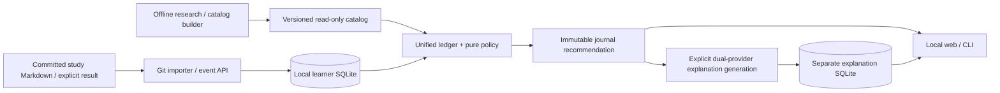

# Recommendation engine: implementation audit

Current journal recommendation: progression-v2 (ADR 006); see [design](../specs/adaptive-progression/design.md), [validation](../specs/adaptive-progression/validation.md) and the [Korean runbook](../specs/mastery-journal/runbook.md). The audit below remains historical.

> Historical snapshot (2026-10-20). Since policy v3 (2026-10-28, ADR 005) the policy counts every completion as solved;
> stored outcomes below are unchanged. Current desktop-readiness state: `specs/desktop-readiness/status.md`.

Audit date: **2026-10-20**. Git baseline: **`a5fcc72485e0a48bf954b459619aeee57d4f4a76`**.
This describes the actual checkout, including uncommitted explanation and calendar-workspace work;
those changes are **not attributed to a released commit**. The follow-up implements focused calendar diagnostics and contest discovery. Original learner
records, timestamps, datasets, problem ranking and Gemini/NVIDIA generation remain unchanged.

## Read this set

| Document | Owns |
|---|---|
| [ALGORITHMS.md](ALGORITHMS.md) | Executed policy, mathematics, embedding/reduction research, checked metrics |
| [DATA_FLOW.md](DATA_FLOW.md) | Input-to-explanation trace and the three-problem investigation |
| [ISSUES_AND_FIXES.md](ISSUES_AND_FIXES.md) | Historical corrections, evidence levels, remaining issues |

**Today's finding:** all three October 20 attempts are persisted and meet the software's
independent/no-hints predicate. The current snapshot counts **two arrays-hashing Easy problems
and one string-processing Easy problem**. The quoted **0/3** matches an older October 18 snapshot
with no attempts. The stored October 20 explanation input already says **2/3**. See DATA_FLOW;
this is not evidence that the present engine lost all three solves.

## Architecture and authority

The canonical learner engine is **JavaScript + local SQLite**, not a remote RAG service.
[ADR 003](../specs/adaptive-learning/adrs/003-local-first-canonical.md) and
[mastery SDD](../specs/mastery-system/design.md) govern it. Python builds immutable catalogs
and runs offline research; `src/learning/store.py` is a recovery/foundation implementation,
not a second active mastery engine. Recommendations work without an LLM or network.

| Layer | Actual implementation and boundary |
|---|---|
| Runtime | [hosted/local.mjs](../hosted/local.mjs) `startLocal`: loopback server; registered Git polling; same learner DB as CLI |
| Learner evidence | [ledger.mjs](../hosted/mastery/ledger.mjs) `readLedger`/`attemptStream`, events and append-only side ledgers; corrections supersede rather than overwrite |
| Catalog | [catalog.mjs](../hosted/mastery/catalog.mjs) `attachCatalog`/`loadCatalog`: receipt/hash verification, read-only SQLite ATTACH, native IDs/difficulty, concepts and cached title neighbors |
| Base policy | [planner.mjs](../hosted/mastery/planner.mjs) `planDay`: reviews, repair, placement/exploit and calendar-rotated exploration |
| Current journal policy | [journal.mjs](../hosted/mastery/journal.mjs) `journalPlan` L33–60: retains base review slots, replaces normal practice with staged `planProgression`, at most one 30-minute progression activity |
| State identity | `createJournalService.view` L65–75 hashes date, catalog, attempts, ratings, preferences, curriculum/pattern and policy source; immutable evidence-revision snapshot |
| Presentation | [hosted/public/app.mjs](../hosted/public/app.mjs), including current uncommitted calendar/workspace surfaces and the journal; `/api/journal` uses the local catalog-backed service |
| LLM prose | [explanations.mjs](../hosted/mastery/explanations.mjs) `withExplanations`: decorates a copy outside the policy hash; explicit `explain` generates both providers concurrently |
| Prose research ledger | [explanation-store.mjs](../hosted/mastery/explanation-store.mjs): private SQLite inputs/attempts/results/cost receipts; independent of learner backup and provider availability |

There are **three different selection surfaces**, not interchangeable algorithms: the small
reviewed-curriculum `/api/state` mission (`hosted/core/policy.mjs`), the broad mastery CLI `plan`
(which freezes a date's first plan), and the evidence-revision journal above. Reading base-planner
exploration code alone does not describe the journal's final practice choice.

## Design decisions and data versions

- Runtime consumes **trusted status**, not proof of correctness: `approved` and `ai_reviewed`
  concepts are accepted by `trustedConcepts`; proposed/abstained concepts are excluded. AI review
  is not human gold. Counts are conditional on this catalog mapping, not the user's explanation text.
- Difficulty remains platform-native. Calibration and progression are distinct: calibrated success
  estimates do not replace the Easy → Medium → transfer → delayed-review gates.
- Frozen catalogs are never edited in place. Current verified `catalog-v4` has **24,303** rows:
  LC 3,053 / CF 11,457 / AtCoder 9,793. Earlier research maps contain **24,297**, not a discrepancy
  to silently normalize. Catalog SHA and details are in DATA_FLOW.
- Title-neighbor retrieval contributes only a labelled channel/eligible fallback; it neither
  diagnoses a user's weakness nor proves algorithm equivalence. No PCA/UMAP/t-SNE coordinates
  select the journal's Easy practice problem.
- LLMs explain existing evidence; they do not choose problems or update mastery. Direct provider
  calls require explicit generation. Page reads/restarts use durable results; missing usage/cost is
  unknown, not zero. [Explanation runbook](../specs/recommendation-explanations/runbook.md).
- No hosted deployment, scheduled delivery or online judge is established by this checkout.
  Langfuse is an optional **offline redacted OTLP export**, not canonical storage; no LangChain,
  Grafana or extra service is required.

## Historical boundary

The removed Baekjoon → LeetCode batch is preserved in `legacy-pipeline-final`. Inspect with
`git show legacy-pipeline-final:src/main/generate_index_map.py`: `search_random_numpy` computes
raw squared-L2, takes a top-10 pool, and randomly samples three; OpenAI embeds title/tag query
text and GPT-4o-mini writes reasons. That path had no learner mastery/review policy. Workflow
removal **`cee364d`** and pipeline removal **`f249dfb`** prevent old README/STAR claims from being
mistaken for current operation. No removed file was restored or quarantined vector re-read here.

## Audit verification and limits

Read-only SQL plus the actual pure ledger/progression functions reproduced both relevant
snapshots. Research checks rehashed saved rankings/projections, recomputed neighbor overlaps
and label counts, and reapplied the language-selection rule (ALGORITHMS). Existing fixture tests
and the 501-file preservation verifier were run; commands/results are in ISSUES_AND_FIXES.
The Quest URL returned a loading shell, so its live enrollment/order was not independently
verified. The initial forensic phase used read-only learner databases. The follow-up fetched public contest
metadata only and tested writes in disposable stores; no real learner record was corrected.
No model training, deployment or statement collection was performed.

Suggested commit after reviewing existing unrelated dirty work: `feat: add cached contest discovery and clarify learning evidence diagnostics`.

## Contest discovery and calendar diagnostics (working-tree implementation)

Specification: [requirements](../specs/contest-discovery/requirements.md),
[design](../specs/contest-discovery/design.md), [tasks](../specs/contest-discovery/tasks.md).

| Layer | Implementation / boundary |
|---|---|
| Public metadata | [contest-discovery.mjs](../hosted/contest-discovery.mjs): `normalizeSchedule`, `fetchDiscovery`, `officialContestUrl`; bounded sources, official-link checks, identity deduplication |
| Durable cache | [provider-service.mjs](../hosted/provider-service.mjs): existing owner-scoped SQLite `provider_cache`; `<platform>:discovery` takes precedence over compatible old `:calendar` entries; no migration |
| Explicit sync | Local-only `POST /api/contests/sync {}`; same-origin enforcement in `local.mjs`; three sources fail independently. State GET and page refresh only read the cache. Submission imports remain separately gated. |
| Personalization | [contest-discovery-fit.mjs](../hosted/mastery/contest-discovery-fit.mjs): `contestDiscoveryFit`, existing `fitAll/predict`, active ledger and immutable catalog; separate from existing problem policy |
| Calendar / modal | `workspace-data.mjs::workspaceEvents` converts actual instants to KST. `workspace.mjs::contestDetails/renderContestList` shows exact date/time, duration, official link, source/cache times, uncertainty and recommendation evidence. Weekends are badges/shading, never date shifts. |
| Import diagnostics | `workspace-data.mjs::syncDiagnostic` and `app.mjs::pollLocalEvidence` distinguish conflicting edits, malformed rows and stopped history reads. No automatic rewrite of imported attempts. |

Run/restart the local server normally (`node hosted/local.mjs`), open **프로그래밍 대회 → 공개 일정 동기화**.
No new API key or infrastructure is needed. GitHub Secrets do not automatically become local process
environment variables; contest discovery does not use Gemini/NVIDIA keys. Existing running Node
processes need restarting to load backend changes. No existing process was stopped by this work.

Live source check at **2026-10-20 16:56 KST**: Codeforces official API **3** contests;
AtCoder official upcoming table **7**; LeetCode CLIST/ContestDeck mirror **2**. These are observed
source counts, not fixed expected schedules. The mirror publication was **2026-10-19 20:34:07Z**,
so the six-hour freshness policy correctly labelled it stale despite successful retrieval.
The UI still displays its last records and directs users to the official pages.

Sources: [Codeforces API](https://codeforces.com/apiHelp/methods#contest.list),
[AtCoder official calendar](https://atcoder.jp/contests/?lang=en),
[ContestDeck feed contract](https://github.com/MaskedCarrot/contestdeck-data#contract),
[CLIST API authentication](https://clist.by/api/v4/doc/).
LeetCode is a disclosed community mirror, not a verified direct LeetCode response. Personal learning
history is never sent to any schedule source. Full validation and remaining limits are in ISSUES_AND_FIXES.
