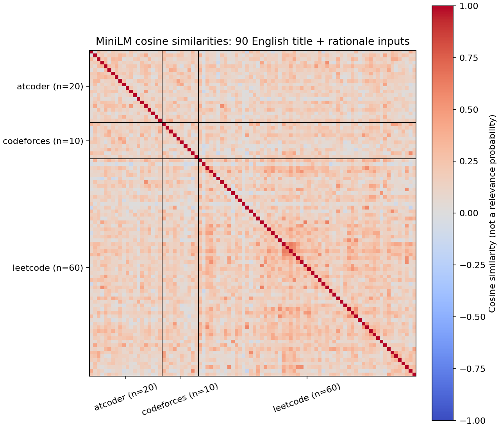
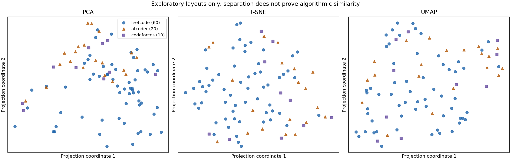

# MiniLM 교차 플랫폼 파일럿 실측 보고서

고정 revision MiniLM을 검토된 영문 제목·요약 90개에 실행했습니다. 코호트는 {"atcoder": 20, "codeforces": 10, "leetcode": 60}이며, 모델 backend·최초 관련 import는 5.012초였습니다. 두 입력 변형은 각각 MiniLM 벡터를 만들었고, encode 시간은 title+rationale 0.166초, title only 0.058초입니다.

이 수치는 해당 개발 머신의 CPU 실행 기록이며 OCI나 운영 비용 추정이 아닙니다.

title_rationale에서 검토 후보만 대상으로 한 평균 nDCG@5: minilm 0.877 (ranking groups 3/query groups 35), tfidf 1.000 (ranking groups 3/query groups 35)

title_only에서 검토 후보만 대상으로 한 평균 nDCG@5: minilm 0.877 (ranking groups 3/query groups 35), tfidf 1.000 (ranking groups 3/query groups 35)

## 설계와 입력

모델: `sentence-transformers/all-MiniLM-L6-v2` / revision `1110a243fdf4706b3f48f1d95db1a4f5529b4d41` (384차원). 모델 파일은 [고정 manifest](model.manifest.json)의 SHA-256으로 확인합니다. 입력은 90개 영어 제목/rationale annotation이며, 전체 메타데이터 카탈로그나 문제 statement가 아닙니다. 플랫폼별 수는 LeetCode 60, AtCoder 20, Codeforces 10입니다. AtCoder 메타데이터는 공식 API가 아니라 AtCoder Problems 커뮤니티 데이터입니다. 명시적 concept tag, 플랫폼명, 난이도는 두 모델 입력 변형에 넣지 않았습니다.

이 파일럿은 로컬 오프라인 CPU 추론으로 실행되어 API 호출 비용은 0입니다. 모델 자산 취득과 연구 의존성 설치에는 별도 다운로드·디스크·CPU 비용이 들며, 아래 시간과 RSS는 현재 개발 머신의 관측값입니다. 운영 또는 OCI 용량 증거로 해석하지 않습니다.

## 임베딩 자원과 입력 길이

| 입력 변형 | encode 초 | 벡터 MiB | 토큰 min / median / max | 256 초과 | norm 범위 |
|---|---:|---:|---:|---:|---:|
| title_rationale | 0.1660 | 0.132 | 10 / 17.0 / 32 | 0 | 1.0000–1.0000 |
| title_only | 0.0584 | 0.132 | 3 / 5.0 / 15 | 0 | 1.0000–1.0000 |

모델 backend 생성·최초 관련 import 시간은 5.0116초, 전체 kernel peak RSS는 774.4 MiB였습니다. RSS는 import·모델·계산·그림을 포함한 프로세스 peak이며 모델의 추가 메모리만 분리한 값이 아닙니다. 입력 token 길이와 truncation 초과 개수는 변형별로 표시했습니다. 모델 최대 길이는 256 token입니다.

## 희소 검토 후보에서의 비교

점수는 `src/learning`의 검토 라벨 평가를 같은 입력 변형의 TF-IDF와 MiniLM에 적용한 결과입니다. 후보가 2개 미만인 query group은 순위 지표에서 제외되며, seed curriculum graph와 겹치는 라벨 행은 제거됩니다. nDCG@5와 Recall@10은 남은 검토 후보 안에서만 계산합니다. 미검토 카탈로그 문제는 순위에 포함하지 않고 음성으로도 취급하지 않습니다.

| 입력 변형 | 방법 | 판정 query groups | ranking groups | 평균 nDCG@5 | 평균 Recall@10 | 후보 커버리지 | 그래프 겹침 제외 행 |
|---|---|---:|---:|---:|---:|---:|---:|
| title_rationale | minilm | 35 | 3 | 0.877 | 1.000 | 0.012 | 22 |
| title_rationale | tfidf | 35 | 3 | 1.000 | 1.000 | 0.012 | 22 |
| title_only | minilm | 35 | 3 | 0.877 | 1.000 | 0.012 | 22 |
| title_only | tfidf | 35 | 3 | 1.000 | 1.000 | 0.012 | 22 |

후보 커버리지는 query/type 별 비-source 카탈로그 후보 중 실제 검토된 비율을 macro 평균한 값입니다. 일부 단일 후보 그룹은 비교 지표에서 빠집니다. 따라서 높은 조건부 점수도 전체 카탈로그 recall, 일반화, 추천 품질의 추정치가 아닙니다. 자료가 희소하므로 모델 승격이나 효과 주장에 쓰지 않습니다. 이 표는 동일 플랫폼과 교차 플랫폼을 포함한 similarity 라벨 전체의 조건부 지표로, 교차 플랫폼만의 독립 성능 점수가 아닙니다. 라벨과 요약은 AI 초안·독립 AI 검토 산출물이며 인간 gold가 아닙니다. 서로 개념적 표현을 공유할 가능성도 있습니다.

## 고정 교차 플랫폼 예시

아래는 사전에 고정한 9개 query의 title+rationale MiniLM 상위 3개 교차 플랫폼 제안입니다. query 선택은 결과를 본 뒤 바꾸지 않았습니다. cosine은 관련성 확률이 아니며 어떤 관계도 승인하지 않습니다.

| Query | 제목 | 상위 3개 제안 (cosine) |
|---|---|---|
| `leetcode:two-sum` | Two Sum | `atcoder:abc083_b` Some Sums (0.443) `atcoder:abc087_b` Coins (0.428) `atcoder:abc058_a` Arithmetic Progression Check (0.424) |
| `leetcode:valid-parentheses` | Valid Parentheses | `codeforces:112A` Petya and Strings (0.343) `atcoder:abc072_b` OddString (0.269) `codeforces:71A` Way Too Long Words (0.261) |
| `leetcode:coin-change` | Coin Change | `atcoder:abc087_b` Coins (0.552) `codeforces:282A` Bit++ (0.345) `codeforces:158A` Next Round (0.306) |
| `atcoder:abc086_a` | Product | `leetcode:product-of-array-except-self` Product of Array Except Self (0.377) `codeforces:4A` Watermelon (0.334) `leetcode:valid-palindrome` Valid Palindrome (0.213) |
| `atcoder:abc086_c` | Traveling | `leetcode:non-overlapping-intervals` Non-overlapping Intervals (0.416) `codeforces:263A` Beautiful Matrix (0.379) `leetcode:minimum-number-of-arrows-to-burst-balloons` Minimum Number of Arrows to Burst Balloons (0.346) |
| `atcoder:abc085_c` | Otoshidama | `leetcode:climbing-stairs` Climbing Stairs (0.288) `leetcode:top-k-frequent-elements` Top K Frequent Elements (0.280) `leetcode:number-of-islands` Number of Islands (0.273) |
| `codeforces:4A` | Watermelon | `atcoder:abc086_a` Product (0.334) `leetcode:trapping-rain-water` Trapping Rain Water (0.225) `atcoder:abc104_c` All Green (0.217) |
| `codeforces:112A` | Petya and Strings | `leetcode:valid-anagram` Valid Anagram (0.475) `leetcode:valid-palindrome` Valid Palindrome (0.459) `leetcode:implement-trie-prefix-tree` Implement Trie (Prefix Tree) (0.408) |
| `codeforces:339A` | Helpful Maths | `atcoder:abc083_b` Some Sums (0.428) `atcoder:abc079_c` Train Ticket (0.312) `leetcode:longest-common-subsequence` Longest Common Subsequence (0.284) |

문제 키는 기존 동결 커리큘럼을 따릅니다. 예제의 `atcoder:abc086_c`는 공식 native task ID `arc089_a`이며, [검토된 ID 대응표](../../assets/problem_identity_aliases.v1.json)를 참조하세요. 이 보고서는 hosted ID 마이그레이션을 수행하지 않습니다.

## 오류 사례 검토

고정 예제 안에서 `coin-change → abc087_b`는 동전 소재가 같지만 최소 동전 수 DP와 제한된 동전 조합 열거를 구별해야 합니다. `valid-parentheses → codeforces:112A`는 스택 기반 괄호 검증과 대소문자 무시 사전순 비교로 풀이가 다릅니다. `abc086_c → non-overlapping-intervals` 역시 Manhattan 거리·시간 패리티와 구간 그리디가 다릅니다. 이는 엔지니어의 정성적 사례 검토이며 새로운 독립 평가 라벨이나 전체 오류율 측정이 아닙니다. 현재의 근접 이웃을 그대로 승인된 학습 관계로 쓰지 않습니다.

## 시각 진단

유사도 행렬은 title+rationale 입력의 90개 코호트 내부 cosine입니다. 숫자는 확률이 아니며 1,536차원 기존 인덱스와 직접 비교하지 않습니다.

PCA/t-SNE/UMAP 파라미터: `{"seed": 17, "tsne_init": "random", "tsne_iterations": 750, "tsne_perplexity": 15, "umap_metric": "cosine", "umap_min_dist": 0.1, "umap_neighbors": 10}`. 이 투영은 작은 코호트의 탐색 그림이며 플랫폼별 분리나 군집 모양은 알고리즘 의미 관계나 추천 유효성을 증명하지 않습니다.

## 실행 provenance와 제한

- 입력 SHA-256 전후 불변: `True`. 벡터 SHA-256: `b19dd5edc65aad3898a2e403f609c8d3b882ca0a003baffade9a97c32d5eaaf8`.
- 모델 학습/승격: `training=False`, `promotion=False`.
- 경고: 8건. 자세한 category, 원문, 횟수는 `results.json`에 보존했습니다.
- 메모리 범위: Whole notebook kernel peak including imports, model and plotting; not incremental model memory or OCI proof.
- 고정 query 설명: Fixed queries, model proposals only; cosine is not relevance probability or approved relationship.
- 실험 구현: [experiment.py](experiment.py). 오프라인 자산 검증과 재현 절차: [모델 manifest](model.manifest.json), [파일럿 명세](../../specs/adaptive-learning/minilm-pilot.md), [자산 검증 도구](../../scripts/learning/assets.py).
- 수치 경고 교차 검증: 두 변형 cosine 행렬을 비-BLAS float64 einsum으로 다시 계산했으며 최대 오차는 9.3e-07입니다. 경고 원인 자체는 미확정입니다.
- 실행 환경 버전과 전체 입력 hash는 [results.json](results.json)에 기록됩니다. 생성된 벡터와 key 파일은 private-learning 경로에 두며 정적 배포 자산에 포함하지 않습니다.

재현에는 저장소의 고정 모델 자산과 연구 의존성이 필요합니다. 사용자 실행기는 `--execute` 시 Hugging Face/Transformers offline 및 telemetry 비활성 환경 변수를 설정한 뒤 같은 저장소 `.venv` 임시 커널을 사용합니다. API나 원격 모델 대체 경로는 없습니다.
