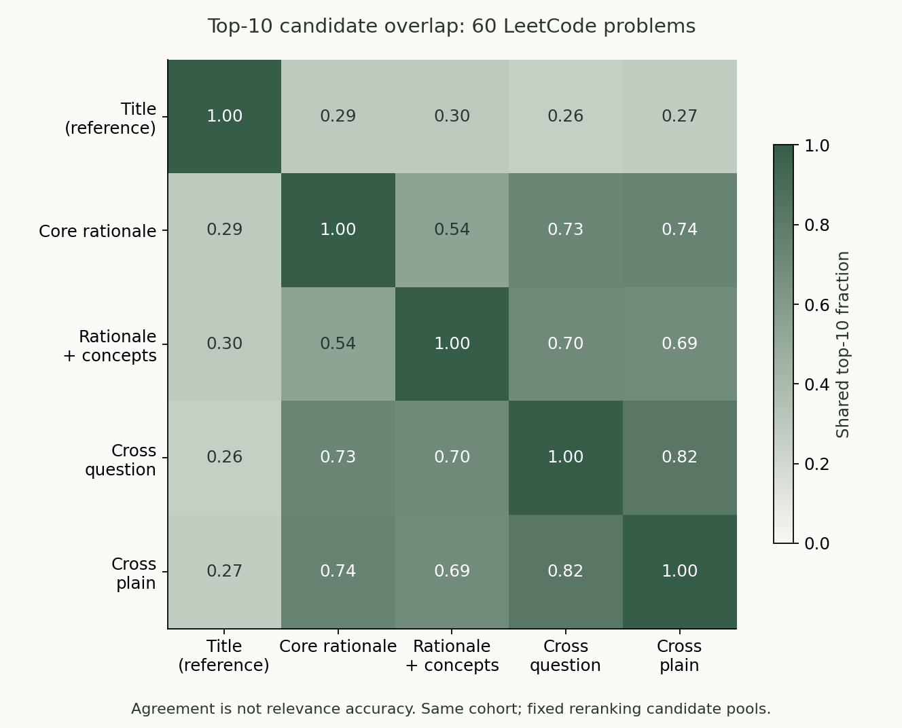
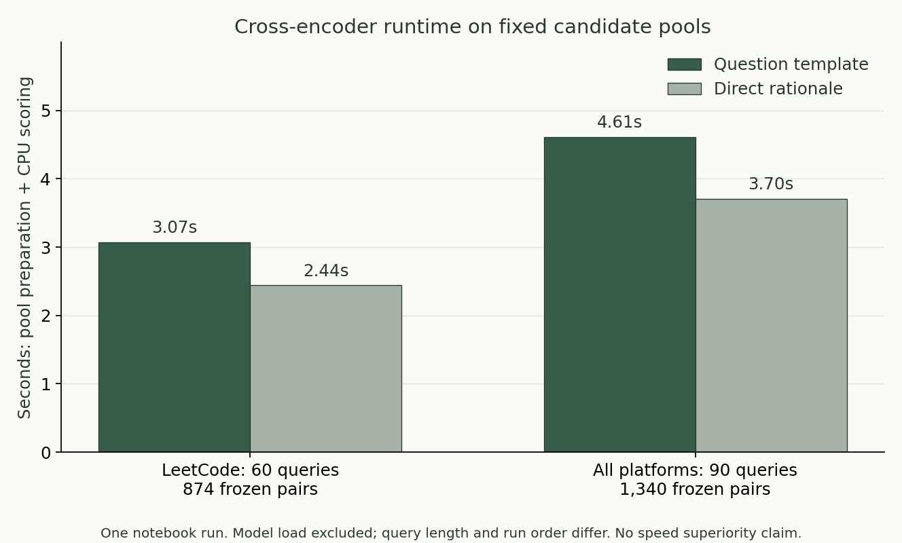

# 제목이 비슷한 문제와 풀이가 비슷한 문제는 달랐다

*2026-10-23 · 로컬 알고리즘 추천 실험 기록 · 블로그 초안*

알고리즘 학습 사이트에 문제 유사도 비교 화면을 붙이고 나니, 숫자로만 보던 문제가 눈에 들어왔다. 제목 코사인이 높은 문제를 눌러 봐도, 지금 익히려는 풀이와 연결되는지 납득하기 어려운 경우가 있었다.

원하는 것은 단순히 비슷한 단어가 들어간 문제가 아니었다. 같은 풀이 아이디어를 다른 문제에 적용해 보고 싶었고, 부족한 개념을 보완하고 싶었고, 때로는 조건이나 과제 자체가 닮은 문제도 찾고 싶었다. 세 목적을 한 숫자로 설명하려던 설계부터 다시 살펴볼 필요가 있었다.

## 먼저, 무엇이 비슷해야 하는가

이번에 세운 구분은 다음과 같다.

| 목적 | 비교할 정보 | 확인할 질문 |
| --- | --- | --- |
| 문제 내용 유사 | 목표, 입출력, 제약 조건 | 요구하는 과제가 비슷한가? |
| 풀이 아이디어 연습 | 핵심 기법, 상태·불변식, 전이, 정당성 | 같은 원리를 적용하는 연습인가? |
| 약점 보완 | 실패·재시도 기록, 필요한 개념, 선수 조건 | 이 학습자에게 지금 도움이 되는가? |

앞의 두 목적도 완전히 같지 않다. 비슷한 이야기를 가진 문제에서 다른 알고리즘이 필요할 수 있고, 전혀 다른 이야기의 문제를 같은 기법으로 풀 수 있다. 약점 보완은 여기에 학습자의 기록과 시점까지 필요하다.

따라서 이 글의 실험은 정적인 내용·풀이 설명 후보를 비교한다. 학습 효과까지 검증했다고 해석하지 않는다.

## 코사인이 문제였을까, 입력이 문제였을까

현재 쓰는 `all-MiniLM-L6-v2`는 batch 안의 문장 pair에 코사인을 계산하고 cross entropy를 적용하는 대조학습으로 훈련됐다. 코사인을 사용했다는 사실만으로 모델 사용이 잘못됐다고 볼 수는 없다. 다만 일반 문장 관계를 학습한 모델이 알고리즘 풀이 관계도 잘 나타내는지는 별도 문제다. [고정 버전 모델 카드](https://huggingface.co/sentence-transformers/all-MiniLM-L6-v2/blob/1110a243fdf4706b3f48f1d95db1a4f5529b4d41/README.md)

코사인은 두 벡터의 방향 관계다. `0.8`을 정답 확률 80%로 읽을 수 없고, 다른 모델이나 다른 입력에서 나온 점수의 크기를 그대로 비교해서도 안 된다. 수치를 바꾸기 전에 무엇을 벡터에 넣었는지 확인하기로 했다.

## 두 개의 데이터 집합을 분리했다

첫째는 기존에 작성·AI 검토한 커리큘럼 설명 90개다. LeetCode 60개, AtCoder 20개, Codeforces 10개로 구성돼 있다. 핵심 풀이 설명과 개념 목록이 있으므로 LeetCode 내부의 아이디어 비교도 가능하다. 이 설명은 원래 문제 본문이 아니며, 사람 정답 라벨도 아니다.

둘째는 기존에 허용된 publisher-description 자료다. 원래 9,424개에서 description/Input/Output을 보수적으로 구분할 수 있는 9,264개만 골랐다. Codeforces 7,989개와 AtCoder 1,275개이며 LeetCode 본문은 없다. 이 집합의 AtCoder 행은 네이티브 task ID가 확인되지 않은 데이터셋 ID를 유지한다.

두 집합의 문제 수나 커버리지를 섞지 않았다. 특히 커리큘럼의 LeetCode 60개를 전체 LeetCode 3,053개에 대한 검증으로 부풀리지 않았다.

## 입력 표현을 바꿔 봤다

커리큘럼 집합에서는 같은 MiniLM과 같은 문제·후보를 사용하면서 세 입력을 새로 임베딩했다.

1. **제목:** 비교 기준선.
2. **핵심 풀이 설명:** 기존 `concept_rationale` 그대로.
3. **구조화 설명:** `CORE IDEA`와 `CONCEPTS`를 구분한 입력.

예를 들어 Two Sum은 다음과 같은 작성 설명을 가진다.

```text
CORE IDEA
Stores prior values so each complement is checked once.

CONCEPTS
hash-map
complement lookup
```

새로운 증명이나 복잡도 설명을 모델이 지어내도록 하지 않았다. 원래 자료에 명시적인 불변식·정당성·복잡도 필드가 없어서 화면에서도 미기록으로 표시했다. 이 입력은 구조화의 출발점이지 완전한 해법 표현은 아니다.

본문 집합에서는 원래 전체 본문 벡터와 비교할 새 입력 두 가지를 만들었다.

- 과제 설명 + Input + Output + 별도 Constraints.
- Input + Output + 별도 Constraints만 사용.

예제 안의 `Input`과 `Output`을 실제 조건으로 잘못 읽지 않도록 구분했고, 중복·누락이 있는 행은 공통 집합에서 제외했다. 긴 입력은 원래 토큰을 254개씩 나눠 처리한 뒤 token 수로 가중 평균했다. 선택한 입력을 모델 길이에 맞춰 조용히 잘라 버리지는 않았다.

이 실험에서 과제·입출력·제약 입력과 전체 본문은 Top10 후보가 평균 **6.73개** 겹쳤다. 입력을 바꾸면 결과가 바뀐다는 사실은 확인했지만, 후보 변화가 곧 품질 향상은 아니다.

## Cross-encoder도 실제로 실행했다

다음에는 `cross-encoder/ms-marco-MiniLM-L6-v2`를 고정 버전으로 다운로드했다. 가중치와 tokenizer 등 7개 파일 합계는 **91,819,431 bytes**였고, safetensors SHA-256을 확인한 뒤 로컬 CPU에서 실행했다.

이 모델은 MS MARCO passage ranking으로 학습된 범용 재정렬 모델이다. 알고리즘의 동등성이나 학습 효과를 판단하도록 학습된 모델이라고 가정하지 않았다. 후보를 먼저 검색하고 일부만 재정렬하는 구조는 [Sentence Transformers의 Retrieve & Re-rank](https://sbert.net/examples/sentence_transformer/applications/retrieve_rerank/README.html)를 참고했다. [모델 카드](https://huggingface.co/cross-encoder/ms-marco-MiniLM-L6-v2)

후보는 핵심 설명 검색과 구조화 설명 검색에서 얻은 Top10의 합집합으로 고정했다. Cross-encoder가 원래 검색에서 놓친 문제를 갑자기 찾아온 것은 아니다.

질문형 입력과 설명을 직접 넣는 입력도 구분했다.

```text
질문형:
Which problem uses the same core solving idea as this? {핵심 풀이 설명}

설명 직접:
{핵심 풀이 설명}
```

후보 쪽에는 두 조건 모두 같은 구조화 설명을 넣었다. 입력 pair는 최대 58 token이었으며 512-token 한계를 넘는 pair는 없었다. 출력은 raw logit으로 보존했다. 음수가 나올 수 있으며, 정답 확률이나 코사인 점수로 표시하지 않았다.

## 실제로 달라진 후보를 봤다

아래는 동작을 설명하기 위해 선택한 세 사례다. 무작위 평가 표본이나 전체 정확도 측정이 아니다.

| 기준 문제 | 구조화 설명 1위 | Cross 질문형 1위 | Cross 설명 직접 1위 |
| --- | --- | --- | --- |
| Two Sum | Contains Duplicate | House Robber | House Robber |
| Valid Anagram | Top K Frequent Elements | Valid Palindrome | Valid Palindrome |
| Binary Search | Search in Rotated Sorted Array | Search in Rotated Sorted Array | Search in Rotated Sorted Array |

Two Sum에서는 두 Cross-encoder 조건 모두 **House Robber를 1위**에 놓았다. 설명에는 각각 complement lookup과 prefix optimum이 등장한다. 같은 핵심 풀이를 연습하려는 목적에서는 납득하기 어려운 결과다. 질문형 문구를 없애도 이 사례는 해결되지 않았다.

Binary Search의 1위는 Search in Rotated Sorted Array로 유지됐다. 일관돼 보이는 사례와 어색한 사례가 같이 나왔다. 몇 개의 예로 전체 성능을 결정할 수는 없지만, 범용 reranker를 붙이면 목적에 맞는 유사도가 자동으로 얻어진다는 기대는 경계하게 됐다.

## 순위 변화와 정확도는 다르다



그래프는 같은 60개 LeetCode 문제에서 후보가 얼마나 겹치는지 보여 준다. 숫자가 높다고 더 정확한 것도, 낮다고 새로운 좋은 문제를 찾은 것도 아니다. 두 방식이 같은 잘못된 후보를 고를 수도 있고, 서로 다른 유용한 후보를 고를 수도 있다.

이번 데이터에는 독립적으로 판단한 아이디어·내용·학습 적합성 라벨이 없다. 그래서 precision이나 nDCG를 만들어 보고하지 않았다. 기존 AI 검토 설명을 곧바로 사람 정답으로 바꾸지도 않았다.

## 계산 비용은 어느 정도였나

최초 CLI 실행에서 측정한 후보군 준비·추론 시간은 다음과 같다. 모델 로드 시간은 각 행에 포함하지 않았다.

| 조건 | 기준 문제 | 후보 pair 수 | 준비·추론 시간 |
| --- | ---: | ---: | ---: |
| 질문형 · LeetCode | 60 | 874 | 3.03초 |
| 질문형 · 전체 | 90 | 1,340 | 4.49초 |
| 설명 직접 · LeetCode | 60 | 874 | 2.46초 |
| 설명 직접 · 전체 | 90 | 1,340 | 3.73초 |



그래프는 저장된 시간을 옮긴 그림이 아니라 **노트북에서 다시 실행한 시간**이다. 최초 CLI 표와 수치가 다를 수 있다. 한 번의 로컬 측정이며 입력 길이·실행 순서·warm-up 효과를 통제한 속도 우열 실험은 아니다.

앞서 계산한 24,303개 제목 벡터의 전체 검색 6.4초를 이 재정렬의 처리시간으로 쓰지는 않았다. 벡터 점곱과 쌍별 모델 추론은 다른 작업이다. 실제 운영에서는 모든 문제를 매번 재정렬할지, 현재 학습 기준 문제만 재정렬할지 따로 정해야 한다.

## 노트북에 남긴 것

[실행된 노트북](recommendation_experiments.ipynb)은 아래 순서로 다시 실행할 수 있다.

- 입력·모델 manifest와 파일 해시 검사.
- 같은 90개 작성 입력을 MiniLM으로 다시 임베딩.
- 두 질문 조건과 60/90개 후보군의 실제 Cross-encoder CPU 추론.
- 저장된 후보 순서와 새 출력의 일치 확인.
- 후보 공통 비율, 사례 표, 추론 시간 시각화.

큰 본문 실험은 노트북 기본 실행에서 다시 돌리지 않고 해시가 고정된 실행 영수증으로 확인한다. 별도 재실행 명령도 노트북에 넣었다. 원문 텍스트와 개인 학습 DB는 공개 노트북 출력에 포함하지 않았다.

[HTML로 읽기](recommendation_experiments.html) · [코드와 실행 영수증](EXPERIMENTS.md)

## 다음은 모델 선택보다 평가 기준

이번 결과를 근거로 새 운영 추천 정책을 배포하지 않았다. 먼저 같은 아이디어/다른 이야기, 비슷한 이야기/다른 해법을 포함한 평가 문제를 만들고 다음을 따로 판단해야 한다.

- 문제 내용의 관계.
- 핵심 풀이 기법의 관계.
- 특정 시점의 학습자에게 필요한 연습인지.

코사인·구조화·Cross-encoder는 이 판단을 돕는 도구다. 도구를 추가했다는 사실이 원하는 관계를 검증한 결과를 대신하지는 않는다. 실제 실패 사례를 확인하고, 어떤 관계를 맞혀야 하는지 명확히 하는 것이 다음 실험의 출발점이다.

---

이 글은 저장소 안의 초안이며 외부 블로그에 게시하지 않았다. 새 모델 훈련·유료 API 호출·기존 추천 순위 변경은 하지 않았다.
