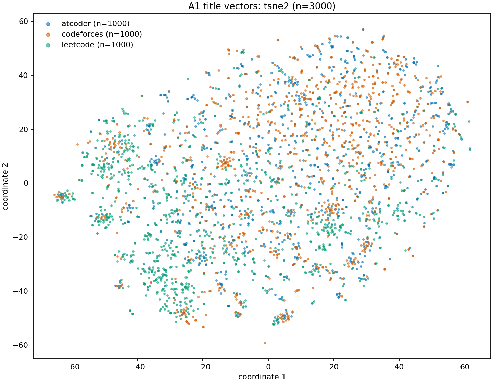

# Unified cross-platform similarity map — 2026-10-17

The versioned research map now represents all 24,297 native catalog problems and
links every admitted publisher statement record through a separate 9,424-row
source index. It does not establish verified algorithm equivalence for every
problem. Existing datasets, experiments and labels remain unchanged. No new
embeddings, collection, training, deployment or model promotion occurred.

## Coverage

| Platform | Native nodes | Retrieval-eligible | Existing title vectors | Native nodes with linked statements | Nonempty native tags |
|---|---:|---:|---:|---:|---:|
| LeetCode | 3,053 | 2,949 | 2,949 | 0 | 2,992 |
| Codeforces | 11,457 | 10,897 | 10,881 | 7,077 | 11,277 |
| AtCoder | 9,787 | 9,608 | 7,467 | 36 | 0 |

All nodes retain original eligibility/encoder flags. The 843 excluded nodes have
no new recommendations; 2,157 additional eligible nodes lack compatible existing
English title vectors. Existing lexical A1-all diagnostics cover 23,454 eligible
nodes and are linked by verified path/hash. Historical LeetCode Premium metadata
limitations remain; eligibility is the frozen research policy, not a newly
verified isPaidOnly classification or permission for public hosting.

The statement source index covers 8,101 Codeforces and 1,323 AtCoder records.
7,113 link to native catalog nodes; 1,020 have a source-native ID outside that
catalog; 1,291 remain unresolved (including four Codeforces records). These are
source identities, not 9,424 additional distinct native problems. Original
statement rankings remain in their separate representation namespace. All 36
user-approved AtCoder mappings are applied as metadata; p03510 remains unresolved
and abc084_c retains both source-quality flags. Identity approval does not verify
statement fidelity.

## Semantic and algorithm evidence

- **Semantic title:** exact blockwise cosine retrieval for all 21,297 reused A1
  MiniLM vectors; Top10/20/50 cross-platform neighbors saved.
- **Algorithm-tag proxy:** Jaccard of direct equivalent taxonomy mappings with
  confidence >=0.85. Original tags, ambiguous mappings and missingness remain
  explicit. 13,605 eligible LeetCode/Codeforces nodes have usable mapped concepts.
  AtCoder has no native tags; no inferred tags replace them.
- **Matched comparison:** semantic, tag and hybrid rankers share exactly 13,590
  query/candidate nodes. Hybrid uses fixed equal-weight reciprocal rank fusion
  (constant 60), over the union of constituent Top50 lists. It is a bounded fusion,
  not exhaustive global hybrid ranking. Zero-Jaccard ties contribute no tag rank.
  Per-edge component scores/ranks/support are saved. Zero-score tag-only outputs
  can still occur and mean no shared concept evidence.
- **Statement semantic:** five frozen methods over 9,424 statement records are
  re-evaluated with approved identity metadata, without rewriting source text.

All native map retrieval masks same-platform/self/representative duplicates and
existing ambiguous duplicate-candidate groups. The latter is a conservative
exclusion policy, not proof that those candidates are exact duplicates.
Tags are editorial platform evidence and the taxonomy is AI-reviewed, not human
gold. Shared broad tags cannot establish the same invariant, complexity,
prerequisite direction or educational transfer. Tag consistency is circular when
used to evaluate a tag ranker and is reported only as a descriptive diagnostic.

## Retrieval evaluation

Reuse all 3,647 directed historical pair records: 2,886 judged, 761 abstained,
44 positives across 23 queries. They are historical AI semantic judgments, not
statement-grounded algorithm labels or human gold. Unjudged slots remain unknown.
Metrics at K=10/20/50 include judged coverage, conditional precision, precision
bounds, common-judged conditional nDCG, hubness, diversity and tag agreement.
Query bootstrap uses 200 resamples, seed 17; duplicate-family independence is not
established. Cross-platform native difficulty distance remains unavailable.

| Top10 matched method | Judged / 135,900 slots | Judged coverage | Positive fraction among judged slots | Mean tag Jaccard |
|---|---:|---:|---:|---:|
| Semantic title | 396 | 0.291% | 2.78% | 0.0735 |
| Tag | 381 | 0.280% | 5.25% | 0.4457 |
| Hybrid | 592 | 0.436% | 4.22% | 0.2814 |

The judged subsets differ, so these conditional precision numbers do not establish
method superiority. Query-mean conditional precision 95% bootstrap intervals are
[0.0067,0.0413], [0.0287,0.1004], [0.0238,0.0758], respectively; they use a different
aggregation from slot-weighted precision in the table. Common-judged nDCG has
positive support from only two queries. No improvement claim is justified.

All-title semantic retrieval has 597 judged Top10 slots of 212,970 (0.280%).
Statement Top10 results have only 1–3 judged slots per method, with no positive
common-judged nDCG support. Sparse unknowns prevent full-catalog relevance or recall
estimation. Each evaluation emits a 500-pair unlabelled stratified review queue;
no labels were fabricated. Difficulty-ordering labels and learner outcomes remain
separate missing evidence.

## Dimensionality reduction

Reuse A1 title vectors, not statement vectors. PCA/SVD fit all 21,297 rows
transductively with fixed randomized solvers/seed 17. Exact cross-platform Top10
preservation uses the same duplicate exclusions as the native semantic run.

| Representation | Mean original Top10 preserved | Vector bytes relative to 384D |
|---|---:|---:|
| Original384 | 100% | 100% |
| PCA256 / 128 / 64 | 87.72% / 77.03% / 59.66% | 66.7% / 33.3% / 16.7% |
| SVD256 / 128 / 64 | 95.74% / 79.92% / 61.17% | 66.7% / 33.3% / 16.7% |

Vector storage is computed from array size, excluding transformation matrices and
runtime overhead. This run persists neighbor indices rather than compressed
vectors or fitted transforms; reproduction refits the seeded algorithms. Exact
Top10 searches took approximately 3.22–3.42 seconds per representation, excluding
fit and output work. Process high-water RSS reached roughly 900 MB cumulatively,
not an isolated method memory measurement. Randomized projection execution emitted
NumPy/Accelerate warnings; outputs passed finite/nonzero normalization checks,
but the warning cause remains unverified.

2D projections use a reproducible 3,000-problem sample (1,000/platform), with saved
sample keys/indices. Their reference is exact cosine neighbors **within that
sample**, not the full catalog. Mean cross-platform Top10 preservation is PCA
5.14%, SVD 3.20%, UMAP 31.50%, t-SNE 36.51%. UMAP uses cosine/15 neighbors/min_dist
0.1; t-SNE cosine/perplexity30/1,000 iterations; seed17. These single-seed visual
probes do not measure algorithm relevance or generalization. No full-catalog
UMAP/t-SNE computation or stability study is claimed.

Additional Top10 quality diagnostics reuse the same sparse historical labels.
Original384 has 597 judged slots (1.84% positive among judged), SVD256 has 596
(1.85%), and PCA256 has 580 (2.07%). These are different selected judged subsets;
small conditional changes cannot demonstrate improvement. Tag agreement remains
about 0.086 for those three. Sampled 2D outputs have only 2–31 judged slots each.
The supplementary `reduction-v2/quality-diagnostics.json` records every method,
unknown coverage and query bootstrap intervals separately by cohort.

Original384 remains the research reference. Neighborhood preservation alone is
insufficient to select or promote a model.

## Deliverables and validation

The private entry point is `private-learning/unified-map/package-v1/manifest.json`.
It binds the final native `map-v2`, `reduction-v2`, statement evaluation, and
statement source index by hashes. `map-v1`/`reduction-v1` are preserved preliminary
runs superseded by reviewed fixes. Use the [executed notebook](comparison.ipynb)
and [HTML report](comparison.html) for aggregate receipts/figures. See
[design review](DESIGN-REVIEW.md) and [implementation review](IMPLEMENTATION-REVIEW.md).

`verify.py` checks every ranked native edge for platform/identity/duplicate
boundaries, source-quality flags, output hashes and the 501-file preservation
snapshot. The map is usable for research inspection; verified algorithmic edges,
AtCoder concepts, comprehensive human relevance, legitimate LeetCode statements
and calibrated cross-platform difficulty remain open evidence gates.
